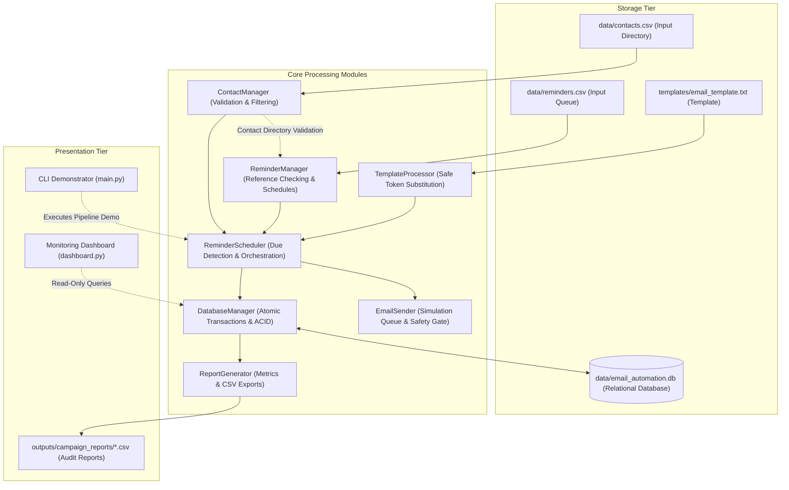
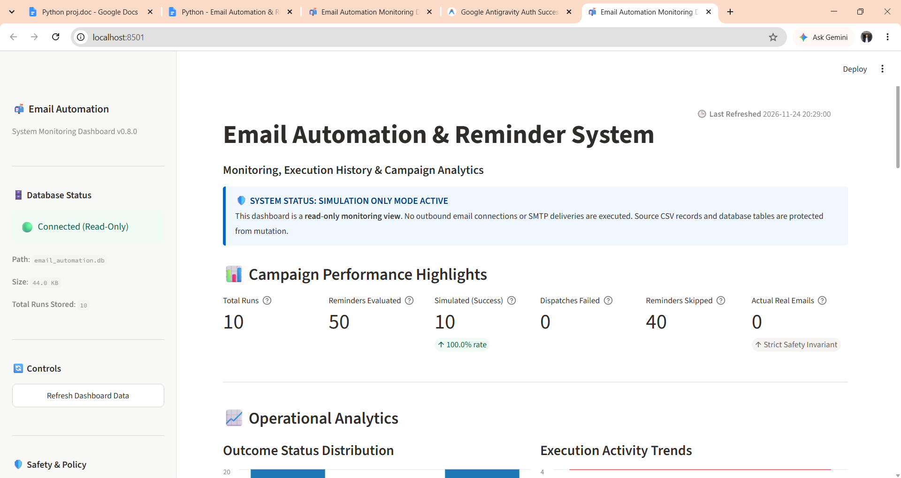
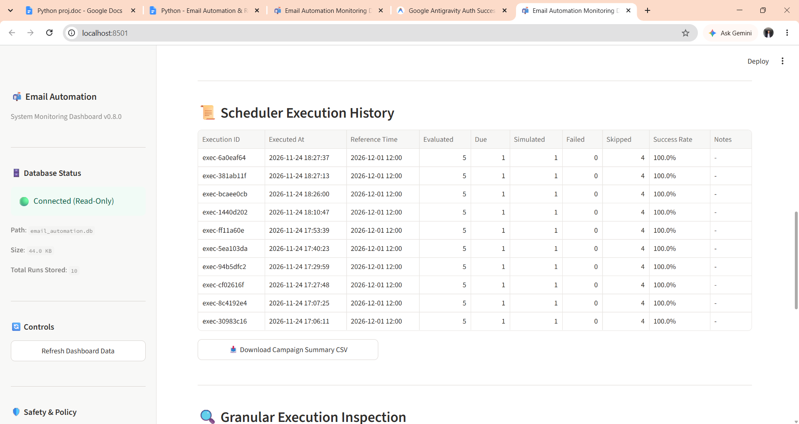
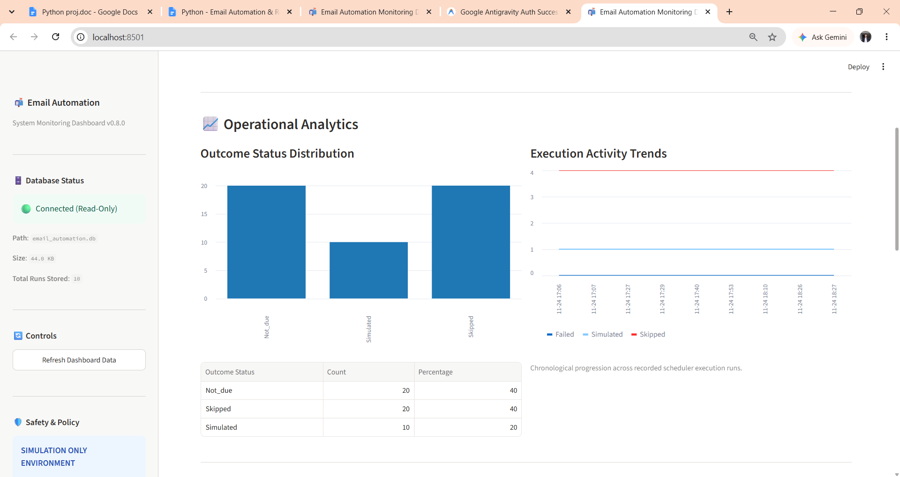
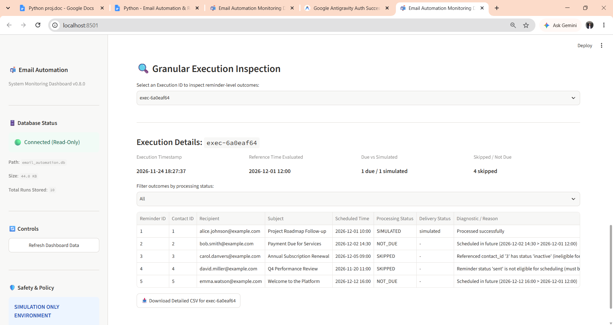

# Email Automation and Reminder System

A modular, fault-tolerant, and simulation-gated Python system engineered for automated contact validation, dynamic email template personalization, schedule evaluation, atomic SQLite persistence, and interactive operational monitoring.

> **MANDATORY SAFETY NOTICE**:  
> Simulated dispatch does not constitute real email transmission or inbox delivery.  
> The application, scheduling engine, and monitoring dashboard operate strictly in simulation mode by default. The count of actual real emails sent is zero. No outbound network sockets or live SMTP dispatches are executed during testing, demonstrations, or standard local operation.

---

## Executive Overview

The Email Automation and Reminder System provides an auditable, automated pipeline for managing time-sensitive notifications, such as client follow-ups, invoice due dates, contract renewal notices, and milestone check-ins.

In many organizations, notification scripts either fail silently when recipient data is malformed or inadvertently create duplicate communications due to a lack of relational validation. This system solves those operational risks by implementing defensive programming principles:
- Relational integrity verification between contacts and scheduled reminders.
- Dynamic template rendering without hazardous string evaluation.
- Strict simulation gating that guarantees safe execution in local and staging environments.
- Relational SQLite persistence with atomic transaction rollbacks.
- Interactive, read-only dashboard monitoring with live status checks and downloadable audit reports.

---

## Business Value and Key Capabilities

### For Managers and Operations Leads
- Risk Mitigation: Hardcoded simulation mode ensures zero accidental dispatches to real customers during internal testing.
- Data Quality Assurance: Contact records are cleansed, normalized, and validated before any communication task is queued.
- Operational Transparency: Real-time visual monitoring displays total dispatches, success rates, and categorized skipping reasons.
- Audit Compliance: Complete historical execution records and individual reminder outcomes can be exported to standard CSV files on demand.

### For Technical Leads and Engineers
- Modular Architecture: Distinct single-responsibility modules for contact management, reminder validation, templating, dispatch, scheduling, persistence, and reporting.
- Defensive Template Engine: Substitutes tokens using verified dictionary context; strictly avoids Python eval() or unconstrained string execution.
- Relational Persistence: Standard library SQLite persistence enforcing foreign-key constraints (ON DELETE CASCADE) and transaction atomicity with automatic rollback on failure.
- Fault Isolation: A failure encountered during the rendering of a single reminder does not halt the execution of subsequent jobs.
- Automated Test Coverage: 124 unit and integration tests passing with 100% success rate across all core subsystems.

---

## System Architecture



---

## Core Components and Module Breakdown

| Module | Source File | Core Responsibility |
| :--- | :--- | :--- |
| Contact Manager | src/contact_manager.py | Ingests contacts, validates RFC 5322 email syntax, normalizes text, removes duplicates, and filters active/inactive records. |
| Reminder Manager | src/reminder_manager.py | Validates reminder records, verifies foreign-key references against ContactManager, parses scheduled timestamps, and identifies duplicate tasks. |
| Template Processor | src/template_processor.py | Loads template files, detects placeholders, validates context completeness, and performs safe string substitutions. |
| Email Sender | src/email_sender.py | Constructs MIME-compliant EmailMessage objects, executes zero-network simulated delivery, and enforces safety gates on live SMTP calls. |
| Reminder Scheduler | src/scheduler.py | Evaluates due reminders against reference times, coordinates the end-to-end pipeline, isolates reminder-level errors, and prevents intra-batch duplicate dispatches. |
| Database Manager | src/database.py | Manages local SQLite connection pooling, enforces foreign-key constraints (ON DELETE CASCADE), executes atomic transactions, and computes campaign metrics. |
| Report Generator | src/report_generator.py | Aggregates operational statistics across historical executions and exports structured RFC 4180 CSV summary files. |
| Logger Configuration | src/logger_config.py | Standardizes timestamped log formatting across modules and sanitizes sensitive data from log records. |
| Monitoring Dashboard | dashboard.py | Provides a responsive, read-only Streamlit user interface featuring KPI highlights, visual distribution charts, filterable history tables, and CSV report downloads. |

---

## Technology Stack

- Language: Python 3.10+ (utilizing dataclasses, type hints, context managers, and pathlib)
- Data Processing: pandas (structured data ingestion, filtering, and chart data formatting)
- Relational Database: SQLite3 (built-in standard library with ACID transactions and foreign-key constraints)
- Email Protocol: email.message.EmailMessage (standard MIME message assembly)
- Network and Transport: smtplib (strictly isolated behind simulation mode and safety gate locks)
- Dashboard Framework: Streamlit (interactive, read-only web presentation)
- Test Framework: pytest (automated regression testing, mock injection, and fixtures)
- Configuration: python-dotenv (environment variable loading via .env with safe defaults)

---

## Dashboard Interface and Visual Analytics

The interactive monitoring dashboard is built with Streamlit and organized into four core monitoring sections.

### 1. Overview and Key Performance Indicators
Displays system header, active simulation mode status, live database health indicators (connection state, file size, record count), and primary operational metrics.


### 2. Operational Analytics and Execution Trends
Presents dynamic bar charts showing outcome status distributions (Simulated, Failed, Skipped, Not Due) alongside chronological line charts tracking activity across historical runs.


### 3. Granular Execution Inspection
Enables filtering by specific execution identifiers to review reminder-level details, including recipient addresses, subject lines, scheduled times, delivery statuses, and diagnostic error logs.


### 4. Health Checks and On-Demand CSV Downloads
Provides single-click in-memory downloads for full campaign summaries and granular run details, generated dynamically without creating temporary file clutter on disk.


*Note on Images: If you have just cloned the repository, screenshot files can be added to the images/screenshots/ directory following the guidelines in docs/screenshot_guide.md.*

---

## Installation and Quick Start

### 1. Prerequisites
- Python 3.10 or higher
- Git version control software

### 2. Clone the Repository
```bash
git clone https://github.com/your-username/Email-Automation-Reminder-System.git
cd Email-Automation-Reminder-System
```

### 3. Create and Activate a Virtual Environment
On Windows (PowerShell):
```powershell
python -m venv .venv
.\.venv\Scripts\Activate.ps1
```

On macOS or Linux:
```bash
python3 -m venv .venv
source .venv/bin/activate
```

### 4. Install Dependencies
```bash
pip install -r requirements.txt
```

### 5. Configure Environment Variables
Copy the template configuration file to create your local settings:
```bash
cp .env.example .env
```
The default configuration remains in safe simulation mode:
```ini
EMAIL_MODE=simulation
ALLOW_REAL_EMAILS=false
```

---

## Running the System

### Option A: Command Line Pipeline Demonstration
Run the deterministic demonstration script to validate data, render sample previews, simulate scheduled dispatches, persist results to SQLite, and export summary CSV files:
```bash
python main.py
```
*Windows Shortcut: You can also double-click `Run_Project.bat`.*

### Option B: Interactive Monitoring Dashboard
Launch the read-only Streamlit monitoring console in your local web browser:
```bash
streamlit run dashboard.py
```
*Windows Shortcut: You can also double-click `Run_Dashboard.bat`.*

The dashboard will open automatically at:
```
http://localhost:8501
```

---

## Automated Testing Suite

The project includes an extensive automated test suite covering unit logic, failure isolation, template security, database transactions, and dashboard data formatting.

Run the test suite with verbose reporting:
```bash
pytest -v
```

### Test Suite Summary (124 Verified Tests)
- tests/test_contact_manager.py: 14 passed (regex validation, whitespace cleanup, deduplication, status filtering)
- tests/test_reminder_manager.py: 20 passed (contact reference checks, timestamp parsing, duplicate tasks)
- tests/test_template_processor.py: 18 passed (placeholder detection, missing variable validation, injection prevention)
- tests/test_email_sender.py: 20 passed (message construction, simulation queue, credential sanitization)
- tests/test_scheduler.py: 12 passed (due reminder detection, duplicate prevention, fault isolation, database persistence)
- tests/test_database.py: 17 passed (schema creation, idempotency, foreign keys, rollback triggers)
- tests/test_report_generator.py: 8 passed (metrics aggregation, empty database handling, CSV formatting)
- tests/test_dashboard.py: 15 passed (status checks, metric calculations, chart transformations, read-only safety, rendering smoke test)

---

## Safety and Security Controls

1. Mandatory Simulation Invariant: The scheduler explicitly forces simulation mode on the dispatch engine. It is structurally impossible for automated routines to transmit real emails.
2. Safety Gate Architecture: In the event live SMTP mode is selected, transmission is blocked unless ALLOW_REAL_EMAILS=true is explicitly set in .env.
3. Read-Only Web Interface: The Streamlit dashboard executes only SELECT database queries and contains no dispatch buttons or transmission triggers.
4. Source File Protection: Raw CSV input files (data/contacts.csv and data/reminders.csv) are read-only and never modified during simulation runs.
5. Credential Sanitization: System loggers automatically sanitize connection strings, passwords, and tokens. The .env file is gitignored and never committed to version control.

---

## Project Structure

```
Email-Automation-Reminder-System/
├── data/                               # Input data files and local storage
│   ├── contacts.csv                    # Contact directory (name, email, status)
│   ├── reminders.csv                   # Reminder queue (schedule, contact reference)
│   └── .gitkeep                        # Git tracking placeholder
│
├── templates/                          # Email body templates
│   └── email_template.txt              # Parameterized plain-text template
│
├── src/                                # Core application source code
│   ├── __init__.py                     # Package declaration (version 0.8.0)
│   ├── contact_manager.py              # Ingestion, validation, deduplication
│   ├── reminder_manager.py             # Reminder validation, reference checking
│   ├── template_processor.py           # Placeholder discovery, string substitution
│   ├── email_sender.py                 # Simulation queue and safety-gated SMTP
│   ├── scheduler.py                    # Due reminder evaluation and fault isolation
│   ├── database.py                     # SQLite persistence, transactions, metrics
│   ├── report_generator.py             # Campaign statistics and CSV reporting
│   └── logger_config.py                # Logging setup and credential sanitization
│
├── tests/                              # Automated test suite (124 tests)
│   ├── test_contact_manager.py         # ContactManager tests (14 tests)
│   ├── test_reminder_manager.py        # ReminderManager tests (20 tests)
│   ├── test_template_processor.py      # TemplateProcessor tests (18 tests)
│   ├── test_email_sender.py            # EmailSender tests (20 tests)
│   ├── test_scheduler.py               # ReminderScheduler tests (12 tests)
│   ├── test_database.py                # DatabaseManager tests (17 tests)
│   ├── test_report_generator.py        # ReportGenerator tests (8 tests)
│   └── test_dashboard.py               # Dashboard tests (15 tests)
│
├── outputs/                            # Generated reports and exports
│   └── campaign_reports/               # Exported campaign and execution CSV reports
│
├── logs/                               # Runtime application logs
│
├── images/                             # Visual documentation assets
│   └── screenshots/                    # Dashboard screenshot directory
│       └── .gitkeep                    # Git tracking placeholder
│
├── docs/                               # Comprehensive project documentation
│   ├── project_documentation.md        # Technical architecture documentation
│   ├── final_project_report.md         # Academic and portfolio project report
│   ├── interview_preparation.md        # Technical interview questions and answers
│   ├── demo_walkthrough.md             # Demonstration video presentation script
│   └── screenshot_guide.md             # Screenshot capture and embedding guide
│
├── dashboard.py                        # Streamlit Interactive Monitoring Dashboard
├── main.py                             # CLI pipeline demonstration orchestrator
├── Run_Project.bat                     # Windows shortcut: run pipeline demonstration
├── Run_Dashboard.bat                   # Windows shortcut: launch monitoring dashboard
├── README.md                           # Project presentation landing page
├── requirements.txt                    # Project dependency specification
├── .gitignore                          # Git tracking exclusion rules
└── .env.example                        # Safe environment template
```

---

## Known Limitations

- Single-Node Persistence: The system uses local SQLite storage suitable for single-node deployments and portfolio demonstrations; horizontal worker clusters require a distributed database such as PostgreSQL.
- Naive Local Timestamps: Scheduled timestamps are evaluated based on local system time without automatic timezone conversion (UTC offsets).
- Discrete Evaluation: The scheduler runs via discrete evaluation cycles (run_once) rather than a persistent background daemon.
- Single-Tenant UI: The Streamlit monitoring dashboard is designed for local evaluation without role-based access control or multi-tenant authorization.

---

## Future Roadmap

- Timezone Awareness: Transition scheduling logic to UTC timestamps with recipient timezone offsets using Python's standard zoneinfo module.
- Persistent Idempotency: Maintain reminder state transitions (pending to simulated/sent) in database storage to prevent re-evaluations across independent application restarts.
- Asynchronous Workers: Integrate Celery or Redis Queue for distributed, asynchronous message construction and batch dispatching.
- Dashboard Authentication: Implement OAuth2 or token-based user authentication on the monitoring console.
- Cloud Provider Transport: Add direct API adapters for transactional email providers (such as Amazon SES or SendGrid) under strict authorization.

---

## License

This project is licensed under the MIT License. Refer to the LICENSE file for details.
