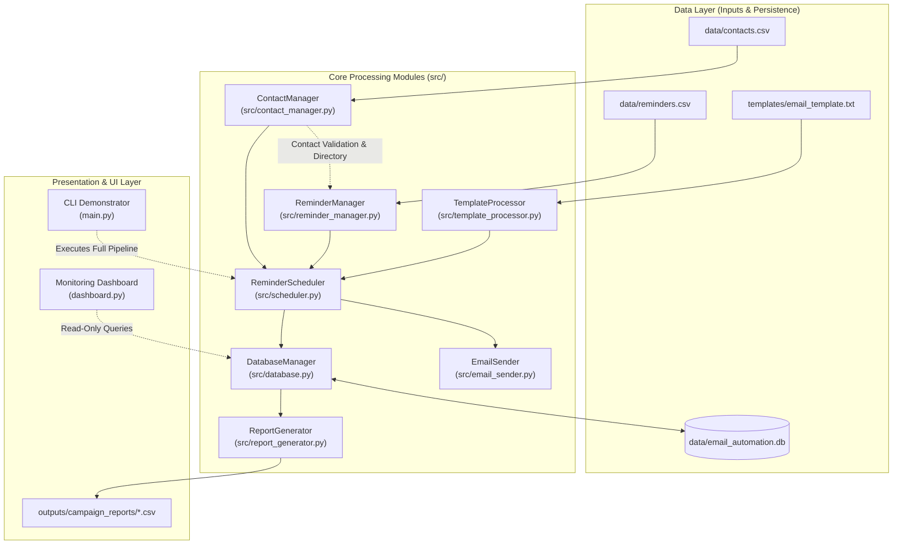

# Final Project Report: Email Automation & Reminder System

**Author:** Student Portfolio Developer  
**Project:** Email Automation & Reminder System  
**Version:** `0.8.0`  
**Date:** November 2026  
**Repository Location:** `C:\ML\Email Automation & Reminder System`  

---

## 1. Title
**Email Automation & Reminder System: A Modular, Fault-Tolerant, and Simulation-Gated Python Architecture for Automated Outreach, Scheduling, Persistence, and Interactive Monitoring**

---

## 2. Abstract
The Email Automation & Reminder System is an extensible, enterprise-patterned Python application designed to address common communication bottlenecks through scheduled, personalized email dispatching. Built with strict separation of concerns, the system incorporates schema validation, reference integrity checks, safe string templating, time-based schedule evaluation, atomic SQLite persistence, automated CSV reporting, and an interactive Streamlit monitoring dashboard. A central tenet of the architecture is its **mandatory simulation-only safety boundary**: automated execution cycles operate in an isolated simulation mode, guaranteeing that no unsolicited network sockets or live SMTP dispatches occur during testing and portfolio demonstration. The project is backed by a 124-test automated regression suite achieving 100% test pass rates across all modules.

---

## 3. Problem Statement
Modern organizations depend heavily on routine, time-sensitive communications—such as meeting reminders, invoice alerts, contract renewals, and onboarding follow-ups. Manual dispatching is error-prone, labor-intensive, and unscalable. Conversely, simplistic script-based automation often suffers from:
1. **Lack of Validation**: Dispatching to invalid email addresses or inactive contacts.
2. **Duplicate Dispatches**: Accidentally spamming recipients when duplicate records exist.
3. **Template Vulnerabilities**: Executing untrusted code or failing silently when template variables are missing.
4. **Safety Risks**: Accidental transmission of real emails to live customer inboxes during local testing or CI/CD pipelines.
5. **Absence of Auditability**: Failure to maintain an immutable, queryable audit trail of evaluated and simulated jobs.

---

## 4. Motivation
This project was developed to bridge the gap between ad-hoc scripting and enterprise-grade software engineering. By building a production-style system using standard library tools and modern Python best practices, the goal was to demonstrate modularity, defensive programming, automated test coverage, database relational integrity, and safe operational monitoring without relying on heavy external enterprise frameworks.

---

## 5. Objectives
1. **Modular Ingestion & Validation**: Ingest contact directories and reminder queues from CSV with strict schema and RFC 5322 regex validation.
2. **Relational Reference Checking**: Cross-reference reminder recipients against the contact directory, identifying missing, invalid, or inactive contacts.
3. **Safe Template Personalization**: Personalize email messages with dynamic placeholders without using hazardous `eval()` or unconstrained string formatting.
4. **Simulation-First Dispatch**: Implement a dual-mode dispatch engine with default zero-network simulation delivery and a safety gate locking out live SMTP.
5. **Deterministic Scheduling Engine**: Automatically identify due reminders based on reference timestamps, preventing intra-batch duplicate dispatches.
6. **Relational SQLite Persistence**: Atomically record execution batches and individual reminder delivery outcomes with ACID transactions and cascading foreign keys.
7. **Operational Reporting & Analytics**: Export RFC 4180 CSV summaries and generate real-time visual analytics via an interactive Streamlit dashboard.

---

## 6. Proposed System
The proposed system decouples data ingestion, validation, template rendering, dispatch, persistence, and visualization into independent, testable components. The entire pipeline operates deterministically and guarantees source data immutability.



---

## 7. System Architecture
The application adheres to clean architectural separation across four distinct tiers:
1. **Persistence Tier**: Standard library SQLite database with foreign key enforcement and source CSV files.
2. **Business Logic Tier**: Modular Python classes enforcing validation rules, template sanitization, and scheduling logic.
3. **Safety & Transport Tier**: Simulated dispatch queue with hardcoded safety locks.
4. **Presentation Tier**: Console CLI orchestrator (`main.py`) and Streamlit web dashboard (`dashboard.py`).

---

## 8. Technology Stack

| Layer | Technology | Justification |
| :--- | :--- | :--- |
| **Language** | Python 3.11+ | Type hints, dataclasses, context managers, clean standard library. |
| **Data Processing** | Pandas | Structured CSV reading, status filtering, DataFrame transformations for dashboard charts. |
| **Scheduling Logic** | Standard `datetime` | Deterministic reference-time comparisons without external daemon dependencies. |
| **Database** | SQLite3 (built-in) | Serverless, zero-config, ACID-compliant relational persistence with foreign keys. |
| **Email Protocol** | `email.message.EmailMessage` | Modern, MIME-compliant message construction following standard RFC specifications. |
| **Dashboard UI** | Streamlit | Rapid, responsive, interactive Python dashboard with built-in visualization tools. |
| **Testing** | Pytest | Fixture-based unit testing, mocking, and automated regression validation. |

---

## 9. Module Descriptions

### 9.1 `ContactManager` (`src/contact_manager.py`)
- Reads and parses contacts from `data/contacts.csv` using project-relative `pathlib.Path`.
- Validates required fields (`contact_id`, `name`, `email`, `status`).
- Validates email formats using standard RFC 5322 regular expressions.
- Performs case-insensitive email deduplication, preserving primary records while flagging duplicates.
- Exposes filtering for active and inactive contacts.

### 9.2 `ReminderManager` (`src/reminder_manager.py`)
- Ingests reminders from `data/reminders.csv`.
- Validates reminder structure and enforces uniqueness of `reminder_id`.
- Cross-references recipient `contact_id` against `ContactManager`:
  - Flags missing contact references (`has_missing_contact`).
  - Flags invalid contact references (`has_invalid_contact`).
  - Flags inactive recipient records (`has_inactive_contact`) to prevent automated outreach.
- Parses ISO/standard date-time strings (`YYYY-MM-DD HH:MM`) and identifies overdue jobs.
- Flags potential duplicate content tuples `(contact_id, subject, scheduled_at)`.

### 9.3 `TemplateProcessor` (`src/template_processor.py`)
- Ingests template files from `templates/email_template.txt`.
- Discovers dynamic placeholder tags matching syntax `{{placeholder_name}}`.
- Validates rendering context against discovered placeholders, rejecting `None` or empty values.
- Performs pure string substitution, strictly avoiding hazardous code evaluation (`eval` is prohibited).
- Exposes `build_context(contact, reminder)` helper to normalize variables.

### 9.4 `EmailSender` (`src/email_sender.py`)
- Assembles MIME-compliant messages via `email.message.EmailMessage`.
- **Simulation Mode**: Generates mock message IDs, delivery timestamps, and structured `DeliveryResult` records without establishing network sockets.
- **Live SMTP Mode (Isolated)**: Supports TLS (port 587) and SSL (port 465) with strict credential sanitization (zero password leakage in logs).
- **Safety Gate**: Rejects live dispatch unless `ALLOW_REAL_EMAILS=true` is explicitly provided.

### 9.5 `ReminderScheduler` (`src/scheduler.py`)
- Evaluates reminders against a reference evaluation timestamp (`scheduled_at <= reference_time`).
- Enforces recipient qualification (must be pending, valid, and active).
- Orchestrates pipeline execution: Reminder $\rightarrow$ Contact $\rightarrow$ TemplateProcessor $\rightarrow$ EmailSender.
- Enforces **Simulation-Only** execution: overrides sender mode to `"simulation"` regardless of environment settings.
- Maintains execution-local duplicate prevention.
- Provides fault isolation: failure of one reminder does not interrupt subsequent reminders.
- Emits structured `SchedulerExecutionReport`.

### 9.6 `DatabaseManager` (`src/database.py`)
- Manages connection lifecycle and schema setup for `data/email_automation.db`.
- Idempotently creates `execution_history` and `reminder_executions` tables with foreign keys and indexes.
- Implements atomic transaction rollback: if any reminder outcome fails insertion, the entire batch rolls back.
- Aggregates operational campaign metrics with explicit `actual_sent: 0` invariant.

### 9.7 `ReportGenerator` (`src/report_generator.py`)
- Aggregates campaign metrics and single execution reports.
- Exports RFC 4180-compliant, UTF-8 encoded summary CSV files to `outputs/campaign_reports/`.
- Exports detailed reminder execution CSV files on demand.

### 9.8 `Dashboard` (`dashboard.py`)
- Read-only Streamlit monitoring console.
- Displays KPI cards, outcome distribution charts, execution trends, and granular audit tables.
- Provides in-memory CSV report downloads.

---

## 10. Data Flow
1. **Ingestion & Validation**: `ContactManager` and `ReminderManager` load raw records, validate types, and link relationships.
2. **Scheduling Evaluation**: `ReminderScheduler` compares reminder timestamps against the evaluation reference time.
3. **Personalization & Construction**: For each due reminder, `TemplateProcessor` renders the body, and `EmailSender` constructs an `EmailMessage`.
4. **Simulated Dispatch**: Message is dispatched to the simulation queue; delivery result is captured.
5. **Atomic Persistence**: `DatabaseManager` commits the execution record and child outcomes within a single SQLite transaction.
6. **Reporting & Monitoring**: `ReportGenerator` exports CSV files, and `dashboard.py` displays real-time analytics.

---

## 11. Database Design

```sql
-- Execution History Table
CREATE TABLE IF NOT EXISTS execution_history (
    execution_id TEXT PRIMARY KEY,
    execution_timestamp TEXT NOT NULL,
    reference_time TEXT NOT NULL,
    total_reminders_examined INTEGER NOT NULL,
    total_due INTEGER NOT NULL,
    total_processed INTEGER NOT NULL,
    total_simulated INTEGER NOT NULL,
    total_failed INTEGER NOT NULL,
    total_skipped INTEGER NOT NULL,
    notes TEXT
);

-- Granular Reminder Executions Table
CREATE TABLE IF NOT EXISTS reminder_executions (
    id INTEGER PRIMARY KEY AUTOINCREMENT,
    execution_id TEXT NOT NULL,
    reminder_id TEXT NOT NULL,
    contact_id TEXT NOT NULL,
    recipient TEXT NOT NULL,
    subject TEXT NOT NULL,
    scheduled_at TEXT NOT NULL,
    processing_status TEXT NOT NULL,
    delivery_status TEXT,
    error TEXT,
    timestamp TEXT NOT NULL,
    message_id TEXT,
    FOREIGN KEY (execution_id) REFERENCES execution_history(execution_id) ON DELETE CASCADE
);
```

### Relational Integrity & ACID Controls
- **Foreign Key Constraints**: Enabled on every connection via `PRAGMA foreign_keys = ON;`.
- **Cascading Deletes**: Deleting an execution record automatically removes associated reminder outcomes.
- **Transaction Rollback**: Inserts are wrapped in `with conn:`. Any exception during child insertion triggers a complete rollback, preventing orphaned or partial records.

---

## 12. Scheduling Logic

A reminder qualifies as due for dispatch if and only if all of the following conditions are satisfied:
1. `is_valid == True`: Structurally complete with valid fields.
2. `status == "pending"`: Sent, failed, or cancelled reminders are ignored.
3. `scheduled_at <= reference_time`: Scheduled time is in the past or matches evaluation time.
4. `contact_id` exists, is valid, and has `status == "active"`.
5. `reminder_id` has not already been processed in the current execution cycle.

---

## 13. Email Simulation and Safety

> **MANDATORY SAFETY STATEMENT**:  
> Simulated dispatch does not constitute real email transmission or inbox delivery. All dispatches performed by the automated scheduler and demonstration scripts run in simulation mode. Actual email count is strictly **0**.

Safety Mechanisms:
- **Hardcoded Scheduler Guardrail**: `ReminderScheduler` forces `email_sender.mode = 'simulation'` upon initialization.
- **Safety Gate Check**: Even if live mode is requested, `EmailSender` requires `ALLOW_REAL_EMAILS=true` in the environment.
- **Read-Only Dashboard**: The dashboard contains no dispatch controls or SMTP connections.
- **Source Immutability**: Source CSV files are never written to during simulation.

---

## 14. Dashboard Features
- **Sidebar Health Probe**: Live database existence, file size, and record count checks.
- **KPI Metrics**: 6 responsive metric cards tracking runs, evaluated reminders, simulated messages, failures, skipped items, and actual real emails (0).
- **Outcome Status Distribution**: Categorical bar chart showing proportions of simulated, failed, skipped, and not-due items.
- **Execution Trends**: Multi-series line chart tracking historical runs chronologically.
- **Granular Inspection**: Dropdown selector to inspect per-reminder outcomes, statuses, and error messages for any run.
- **In-Memory CSV Downloads**: One-click download buttons for campaign summaries and detailed execution reports.

---

## 15. Testing Methodology

The test suite is structured into isolated pytest modules using fixtures, temporary directories, and unit mocks:
- `test_contact_manager.py`: 14 tests (regex, whitespace, duplicates, status filtering).
- `test_reminder_manager.py`: 20 tests (reference checking, date parsing, duplicate content).
- `test_template_processor.py`: 18 tests (placeholder detection, missing variables, code injection prevention).
- `test_email_sender.py`: 20 tests (message construction, simulation queue, credential sanitization).
- `test_scheduler.py`: 12 tests (due detection, duplicate protection, fault isolation, DB persistence).
- `test_database.py`: 17 tests (schema creation, idempotency, foreign keys, rollback triggers).
- `test_report_generator.py`: 8 tests (metric calculation, empty DB handling, CSV formatting).
- `test_dashboard.py`: 15 tests (status probing, metrics, chart transformations, read-only safety, rendering smoke test).

**Total Regression Baseline**: **124 passing tests** (100% pass rate).

---

## 16. Results
- **Pipeline Execution**: Successfully demonstrated end-to-end processing of real sample CSV files with zero errors.
- **Persistence Verification**: 100% of evaluated reminders and execution summaries persisted cleanly to SQLite.
- **Immutability Verification**: SHA-256 and row counts of `data/contacts.csv` and `data/reminders.csv` confirmed completely unaltered.
- **Zero Sockets**: Confirmed zero network connections established during testing or demonstrations.

---

## 17. Limitations
1. **Local Single-Node Deployment**: Runs locally on a single machine using SQLite.
2. **Naive Local Datetimes**: Assumes uniform local time (`YYYY-MM-DD HH:MM`) without timezone awareness (e.g. UTC offsets).
3. **Finite Demonstration Execution**: Uses `run_once()` rather than an autonomous background daemon.
4. **Execution-Local Duplicate Protection**: Intra-batch deduplication is in-memory; persistent cross-session idempotency requires future database status update locks.
5. **Read-Only Dashboard**: The dashboard monitors history but cannot trigger dispatches or edit contacts.

---

## 18. Future Scope
1. **Timezone Support**: Migrate scheduling logic to UTC timestamps with recipient timezone offsets using Python's `zoneinfo`.
2. **Persistent Idempotency**: Update reminder statuses in database/CSV to prevent duplicate dispatch across independent application restarts.
3. **Background Daemon**: Integrate an async task queue (e.g., Celery, Redis) or robust cron scheduling daemon.
4. **Authentication & Multi-Tenancy**: Add user authentication (OAuth2 / JWT) to the Streamlit monitoring interface.
5. **Real SMTP Support with Provider APIs**: Implement production email provider adapters (SendGrid, AWS SES) under strict authorization.

---

## 19. Conclusion
The Email Automation & Reminder System demonstrates that reliable, maintainable automation software requires rigorous defensive engineering: comprehensive data validation, safe templating, strict simulation boundaries, atomic database persistence, and transparent monitoring. The project provides a solid, portfolio-ready foundation exhibiting enterprise software engineering patterns, complete test automation, and uncompromising safety.
